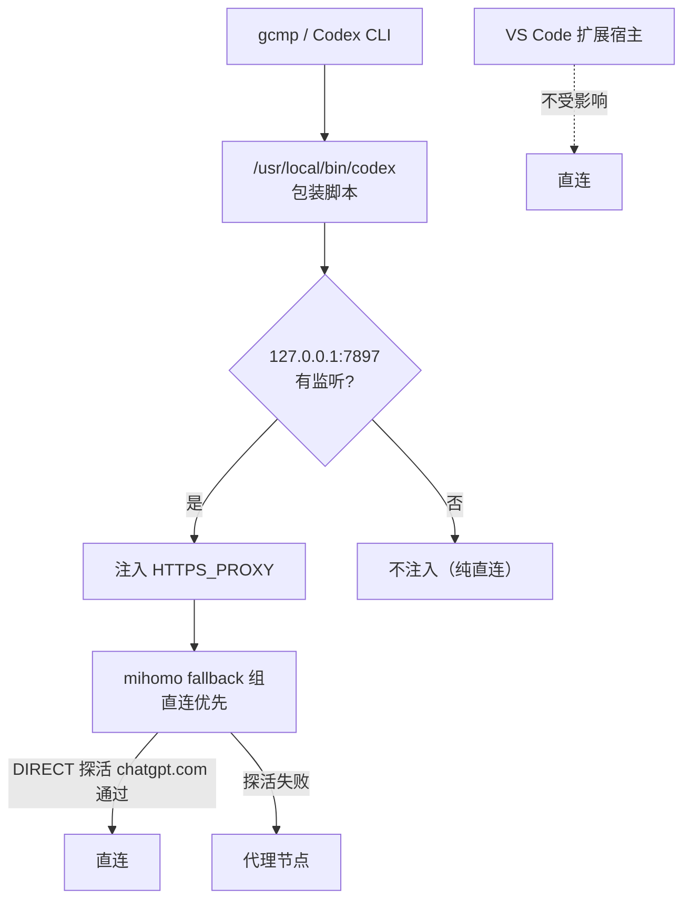

# CloudServer-Codex-Vpn

让**没有境外网络出口的云服务器**（阿里云 ECS、腾讯云等）上也能正常使用：

- `gcmp` 扩展里的 **Codex CLI**（`vicanent.gcmp`）
- 官方 `openai.chatgpt` 扩展
- 命令行 `@openai/codex`

核心思路：**只给 codex 进程注入代理**，不污染 VS Code 远程扩展宿主的环境变量，同时提供「**先直连、不通再走代理**」的自动回退策略。

---

## 为什么需要这个项目

国内云服务器访问 `chatgpt.com` / `api.openai.com` 会直接超时，而 Codex CLI 的登录与推理都必须访问这些域名。

直接往 `~/.bashrc` 里写 `HTTP_PROXY` 会让 VS Code 远程扩展宿主也走代理，`gcmp` / `Copilot` 这类扩展会立刻报 `Connection error`。本项目用**进程级包装脚本**绕开这个问题。

## 架构



两个关键设计：

| 设计 | 目的 |
| --- | --- |
| 代理只注入 codex 子进程 | gcmp / Copilot 等扩展的网络请求保持直连，避免 `Connection error` |
| `fallback` 组 + `DIRECT` 排第一 | 能直连就直连（低延迟、省流量），直连不通才自动切节点 |

## 两种方案

### 方案 A：远端自建 mihomo（推荐）

服务器自己跑代理内核，不依赖你的电脑是否开机。

```bash
# 1. 安装 mihomo 内核 + systemd 服务
sudo bash scripts/install-mihomo.sh

# 2. 写入机场 Clash 订阅并重建配置（直连优先策略）
sudo bash scripts/update-sub.sh "https://your-airport.example.com/api/v1/sub?token=REDACTED"

# 3. 安装 codex 包装脚本
sudo install -m 755 scripts/codex-wrapper.sh /usr/local/bin/codex
# 需保证 /usr/local/bin/codex.real 指向真实的 codex 可执行文件

# 4. 验证
curl -s -x http://127.0.0.1:7897 -o /dev/null -w "%{http_code}\n" https://chatgpt.com
# 期望输出 200
```

登录 Codex（无图形界面的服务器用 device code）：

```bash
codex login --device-auth
# 按提示在浏览器打开链接并输入一次性代码
```

### 方案 B：借用本地电脑的网络（无订阅时的备选）

本地电脑能直连 OpenAI、但服务器不能时，用 SSH 反向隧道把本机出网能力借给服务器。

```bash
# 本机：跑一个最小 HTTP CONNECT 代理（直连出网）
python scripts/local-http-proxy.py

# 本机：开反向隧道到服务器
ssh -N -R 7897:127.0.0.1:7897 <server>

# 服务器：验证
curl -s -x http://127.0.0.1:7897 -o /dev/null -w "%{http_code}\n" https://chatgpt.com
```

缺点：依赖本地电脑常开、隧道常连。

## 目录结构

```
scripts/
  install-mihomo.sh     安装 mihomo 内核 + systemd 服务（含内存上限）
  gen-config.py         由机场订阅生成 mihomo 配置（直连优先 fallback 组）
  update-sub.sh         更新订阅并重建配置（可挂 cron）
  codex-wrapper.sh      包装脚本：仅给 codex 进程注入代理
  local-http-proxy.py   方案 B 用的最小 HTTP CONNECT 代理
docs/
  troubleshooting.md    踩坑记录：DNS 污染、geodata 下载、探测目标选择等
  verify.sh             一键检查链路是否正常
```

## 日常维护

```bash
# 订阅换链接或定期刷新
sudo bash scripts/update-sub.sh "新订阅链接"

# 建议挂 cron，防止订阅链接过期导致节点全挂
echo "0 4 * * * bash /root/update-sub.sh >/dev/null 2>&1" | crontab -
```

## 安全约定

仓库**不包含**任何真实凭据。以下内容全部留给使用者本地填写，且已加入 `.gitignore`：

- 机场订阅链接（含 token）
- `~/.codex/auth.json`（OAuth 凭据）
- 生成出来的 `config.yaml`（含节点 server / uuid）
- 服务器 IP、主机名、用户名

## 已知限制

- `ping` 走 ICMP，HTTP 代理无法转发，**永远 ping 不通**，这是正常现象；用 `curl -x` 验证才有意义
- 单核小内存机器（如 1.8G）跑 Codex agent 容易顶到 swap，建议 ≥ 4G
- `gcmp` 依赖 `PATH` 中的 `codex` 命令与 `~/.codex/auth.json` 判断登录状态，换过脚本后需重载 VS Code 窗口

## License

MIT